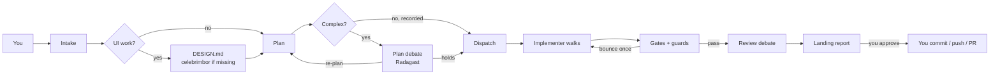
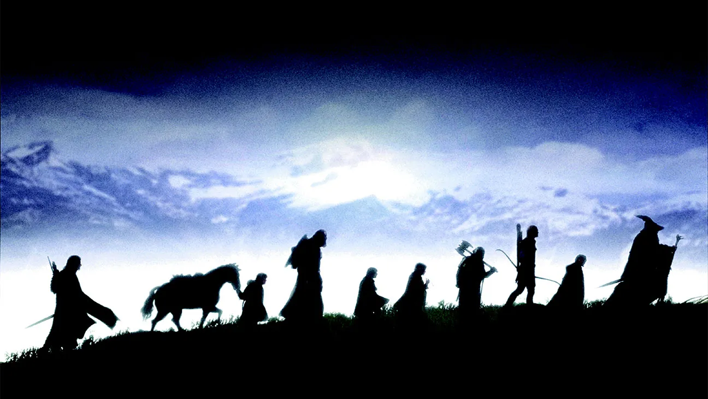

<div align="center">


# gandalf

**A delegation fellowship for your coding agent — free models, paid seats, or both.**

*"A wizard is never late, nor is he early. He arrives precisely when he means to."*

[](https://skills.sh/ahmed-elkashif/gandalf)
[](LICENSE)

</div>

---

## What it does

**gandalf is a delegation layer for the coding agent you already use.** It is not a new model, CLI, or hosted service.

One model cannot be great at everything. A drawer full of good skills helps nothing if the wrong model is holding them. gandalf gives your agent a **delegation fleet**:

- **Route** — pick a lane, write a self-contained brief, and dispatch a headless implementer.
- **Equip** — give each lane the skills it needs: UI craft, debugging discipline, guards, design language.
- **Review** — run the gates, block broken UI with `qa`, debate the diff with a second model, and return one landing report. Nothing is committed without you.

Four skills ship together:

| Skill | Job |
|---|---|
| [`council-of-elrond`](skills/council-of-elrond/SKILL.md) | **Setup.** Arms the packs, discovers your CLIs, casts the fleet, writes config and preambles, verifies the cast. |
| [`gandalf`](skills/gandalf/SKILL.md) | **Daily use.** Intake, plan gate, dispatch, guards, review, landing report. Never writes the code. |
| [`palantir`](skills/palantir/SKILL.md) | **UI evidence.** The page's own WebMCP tools, the DOM timeline, and the network HAR. The `qa` behaviour gate. |
| [`celebrimbor`](skills/celebrimbor/SKILL.md) | **Design language.** Forges or adopts a validated `DESIGN.md` before `ui` dispatches. |

`palantir` and `celebrimbor` are first-party child skills. The default install includes all four; if you install selectively, include them.

## Quickstart

**You need:** Node 18+, a coding agent that supports skills (OpenCode, Claude Code, Codex, Cursor, Gemini CLI, Antigravity, and [many more](https://github.com/vercel-labs/skills#supported-agents)), and at least one implementer CLI installed and authenticated.

```bash
npx skills add Ahmed-ElKashif/gandalf
```

Then, in your agent:

```text
# 1 — cast the fleet. One budget question; the council shows the install
#     delta and the final cast before it writes the fleet config.
Use $council-of-elrond to set up my delegation fleet

# 2 — put it to work. gandalf runs intake, the plan gate, dispatch, gates,
#     review debate, and returns one landing report.
Use $gandalf to add retry logic to src/sync/, then review it
```

When the landing report arrives, **you** review the diff and commit, push, or open the PR. gandalf never commits.

<details>
<summary>More install options</summary>

```bash
# browse before installing
npx skills add Ahmed-ElKashif/gandalf --list

# one skill only — include palantir and celebrimbor if you want the full loop
npx skills add Ahmed-ElKashif/gandalf --skill gandalf
npx skills add Ahmed-ElKashif/gandalf --skill council-of-elrond
npx skills add Ahmed-ElKashif/gandalf --skill palantir
npx skills add Ahmed-ElKashif/gandalf --skill celebrimbor

# target specific agents
npx skills add Ahmed-ElKashif/gandalf -a opencode -a claude-code

# global, non-interactive (fresh machines, CI)
npx skills add Ahmed-ElKashif/gandalf -g -y

# pin a release (git ref)
npx skills add Ahmed-ElKashif/gandalf#v1.1.0
```

**Manually** — copy a skill folder into your agent's skills directory:

| Target | Path |
|---|---|
| Shared store (OpenCode, Codex, Cursor, Gemini CLI, Antigravity, …) | `~/.agents/skills/<skill>/` |
| Claude Code | `~/.claude/skills/<skill>/` |

**Windows convenience path** — installs the core and UI packs in manifest order, then applies the verified patches:

```powershell
skills/gandalf/scripts/install-skills.ps1
```

This is a fallback. The recommended path is `council-of-elrond`, which reads the same `packs.json`, shows the delta, and takes one approval before arming.

</details>

## How a run works



A **relay** is the headless CLI runner. A **bounce** is one retry with findings. **Gates** are lint/test/build plus the guards. The **landing report** is the single summary you see before anything lands.

Every relay follows the same contract: self-contained brief in; structured report and a not-yet-committed diff out; **never commits**.

Four rules the loop enforces:

| Rule | The quote |
|---|---|
| Gates before landing. | *"You shall not pass."* |
| Smallest change that works. | *"Even the smallest person can change the course of the future."* |
| Two failed attempts → escalate. | *"Fly, you fools!"* |
| Evidence before claims. | *"The wise speak only of what they know."* |

More detail: [`gates.md`](skills/gandalf/references/gates.md), [`plan-debate.md`](skills/gandalf/references/plan-debate.md), [`operations.md`](skills/gandalf/references/operations.md).

## The fleet

<div align="center">

</div>

Eleven roles: **eight walk, three judge.** LOTR names are display aliases; wire names are what the machinery resolves. Use the wire name in dispatch; use either in conversation.

| LOTR name | Wire name | Job |
|---|---|---|
| **Aragorn** | `feature` | full-stack feature work |
| **Galadriel** | `ui` | frontend and design craft |
| **Elrond** | `bugfix` | debugging and root-cause work |
| **Gimli** | `devops` | CI, CD, infrastructure |
| **Samwise** | `chores` | maintenance and mechanical edits |
| **Glorfindel** | `complex` | frontier reasoning; one deep pass |
| **Haldir** | `qa` | UI behaviour gate; no vision needed |
| **Legolas** | `qa-look` | appearance pass; the only vision seat |
| **Radagast** | `plan-debate` | challenges the plan before dispatch |
| **Faramir** | `review-main` | second-opinion reviewer |
| **Saruman** | `review-debate` | stronger challenger |

`qa` is a **behaviour gate, not an advisor**: a UI change is not done until `qa` returns a clean `palantir` round. It needs no vision. `qa-look` judges appearance against `DESIGN.md`; its verdict is advisory and can never override `qa`. A beautiful broken page still fails.

Full casting profiles and what each role carries: [`fleet.md`](skills/gandalf/references/fleet.md) and [`loadouts.md`](skills/gandalf/references/loadouts.md).

## Cast your own

**Free-first is the shipped default, not the only path.** The same loop runs on free models, paid subscriptions, local GPUs, or a mix. If you already pay for Claude Code, Codex, opencode Go, Cursor, Warp, or another agent, cast those seats where they earn their keep.

| Posture | Good for | Example cast |
|---|---|---|
| **Free-first** (shipped) | no paid API key; free tiers and an existing Antigravity seat | free OpenCode models for the flat roads; agy Opus for `complex`, `plan-debate`, `review-debate` |
| **Subscription / paid** | Claude Code, Codex, opencode Go, Cursor, Warp, or another paid agent | your paid model for `feature` / `ui` / `complex`; a cheaper model for `chores`; free or local for `qa` |
| **Local + mixed** | a GPU on the desk, or privacy-sensitive work | Ollama / LM Studio via opencode for flat roads; one cloud seat for `complex` |

The dispatch relays currently cover `opencode`, `agy` (Antigravity), `claude`, `codex`, `cursor`, and `warp`. The skills CLI can install into more agents than that; check [`delegate-skills`](https://github.com/amElnagdy/delegate-skills) for the latest list.

### The shipped free-first preset

[`presets/free-first.json`](skills/gandalf/presets/free-first.json) uses free OpenCode models for the flat roads and an Antigravity Opus seat for `complex`, `plan-debate`, and `review-debate`.

The honest trade: in that preset `complex`, `plan-debate`, and `review-debate` all ride the same Antigravity Opus seat, so the two debate judges share a model. That is a legitimate budget choice, but it is not a second opinion. If you pay for a second strong model, cast it.

Full cast and dials: [`fleet.md`](skills/gandalf/references/fleet.md). The preset itself: [`free-first.json`](skills/gandalf/presets/free-first.json).

### If you already pay for an agent

Don't downgrade to free models just because the preset is free-first. Cast the seats you pay for where they matter:

- `feature`, `ui`, `complex` — your strongest paid model (Claude Code, Codex, opencode Go, or another relay).
- `bugfix` — a reasoning-heavy paid model if you have one.
- `chores` — the cheapest capable model, free or paid.
- `qa` — text-only is fine; `qa-look` is the only seat that needs vision.

Mix freely: paid `feature` / `complex`, free `chores` / `qa`, local `ui`. A one-line change moves a role; nothing else in the loop notices. The reverse works too: start free, then swap in paid seats as your budget allows.

<div align="center">

</div>

## Setup in detail

`council-of-elrond` turns “I have some CLIs installed” into “I have a working fleet”:

1. **Arm** — read [`packs.json`](skills/council-of-elrond/packs.json), show the delta (missing packs, tier, licence, roles served), take one approval, install in file order, apply verified patches.
2. **Discover** — probe PATH for implementer CLIs, auth status, and models.
3. **Cast** — ask one budget question, propose the lanes, show the full cast, take one approval, write the fleet config (`delegate-fleet.v1`).
4. **Verify** — write the lane preambles, resolve every lane, run the reviewer health check.

`delegate-skills` is installed first, always: it ships the relays and the `delegate-setup` engine. The council ships its own copy of the discovery/validation engine, so **casting** needs no extra package; **dispatch** still uses the `delegate-skills` relays.

Three upstream fixes are carried as verified patches and applied after installs. `patch-skills.mjs check` exits nonzero on `pending` or `drift`; it refuses to guess when upstream changes. Detail: [`arming.md`](skills/council-of-elrond/references/arming.md) and [`NOTICE.md`](skills/council-of-elrond/NOTICE.md).

<div align="center">

</div>

## Verify and contribute

The workflow is specified in Markdown, so the docs are part of the machinery:

```bash
npm test        # preamble injector tests
npm run check   # roles, aliases, templates, stale copy, dead links, packs URLs, credits
```

Both run in CI. If you change a role, a doc, a template, or a pack, run both before opening a PR.

- **Questions or bugs:** [open an issue](https://github.com/Ahmed-ElKashif/gandalf/issues).
- **Repo layout and patch policy:** [`CONTRIBUTING.md`](CONTRIBUTING.md).
- **Maintainer:** [Ahmed ElKashif](https://github.com/Ahmed-ElKashif).

## Prior art

The loop follows patterns that hold up in production: orchestrator-workers and evaluator-optimizer (Anthropic), owned prompts, context, and control flow plus small focused agents (12-factor agents), and explicit guardrails with human checkpoints (OpenAI). The mapping — and what gandalf deliberately does differently — is in [`prior-art.md`](skills/gandalf/references/prior-art.md).

## Credits

The fellowship stands on other people's work. This table mirrors [`packs.json`](skills/council-of-elrond/packs.json), the same file the council arms from: every installable pack is credited, nothing else is, and the order is install order. `unverified` means the licence has not been checked yet — a to-do, not a claim.

<details>
<summary>All 26 packs, in install order</summary>

| Pack | Licence | Why it is here |
|---|---|---|
| [`amElnagdy/delegate-skills`](https://github.com/amElnagdy/delegate-skills) | MIT | headless relays + the `delegate-setup` engine, vendored into the council |
| [`amElnagdy/review-skills`](https://github.com/amElnagdy/review-skills) | MIT | `debate-review` and `babysit-pr` |
| [`amElnagdy/guard-skills`](https://github.com/amElnagdy/guard-skills) | MIT | clean-code, test, and docs guards |
| [`DietrichGebert/ponytail`](https://github.com/DietrichGebert/ponytail) | MIT | the smallest-change ladder |
| [`obra/superpowers`](https://github.com/obra/superpowers) | MIT | writing-plans, systematic-debugging, review discipline |
| [`mattpocock/skills`](https://github.com/mattpocock/skills) | MIT | grilling, to-tickets, code-review, domain-modeling |
| [`palantir`](skills/palantir/) | MIT | our UI evidence child skill: WebMCP + DOM timeline + HAR |
| [`celebrimbor`](skills/celebrimbor/) | MIT | our `DESIGN.md` forge child skill |
| [`amelnagdy/ui-review-loop`](https://github.com/amelnagdy/ui-review-loop) | Apache-2.0 | optional video loop; the recorder ancestor |
| [`vercel-labs/agent-browser`](https://github.com/vercel-labs/agent-browser) | unverified | the browser backend `palantir` drives |
| [`emilkowalski/skills`](https://github.com/emilkowalski/skills) | MIT | interface craft and motion |
| [`Leonxlnx/taste-skill`](https://github.com/Leonxlnx/taste-skill) | MIT | art direction for public surfaces |
| [`ibelick/ui-skills`](https://github.com/ibelick/ui-skills) | MIT | UI systems, accessibility, metadata |
| [`anthropics/skills`](https://github.com/anthropics/skills) | unverified | `frontend-design` for identity asks |
| [`vercel-labs/agent-skills`](https://github.com/vercel-labs/agent-skills) | unverified | React performance and view transitions |
| [`greensock/gsap-skills`](https://github.com/greensock/gsap-skills) | MIT | GSAP, only when it is already a dependency |
| [`supabase/agent-skills`](https://github.com/supabase/agent-skills) | unverified | Supabase / Postgres backends |
| [`prisma/skills`](https://github.com/prisma/skills) | unverified | Prisma projects |
| [`mongodb/agent-skills`](https://github.com/mongodb/agent-skills) | unverified | MongoDB schema and query work |
| [`kadajett/agent-nestjs-skills`](https://github.com/kadajett/agent-nestjs-skills) | unverified | NestJS backends |
| [`wshobson/agents`](https://github.com/wshobson/agents) | MIT | Next.js, Tailwind, TypeScript, and Actions patterns |
| [`shadcn-ui/ui`](https://github.com/shadcn-ui/ui) | unverified | shadcn component work |
| [`langchain-ai/langchain-skills`](https://github.com/langchain-ai/langchain-skills) | unverified | LangChain / LangGraph projects |
| [`addyosmani/agent-skills`](https://github.com/addyosmani/agent-skills) | MIT | CI/CD for the `devops` lane |
| [`github/awesome-copilot`](https://github.com/github/awesome-copilot) | MIT | GitHub Actions hardening |
| [`getsentry/skills`](https://github.com/getsentry/skills) | Apache-2.0 | `security-review`, outside the loop |

</details>

Also:

- **Models** — the free-first preset rides OpenCode's free tier and Antigravity (Google).
- **Images** — Gandalf stills © Warner Bros. / New Line, included as a fan homage.

## License

MIT — see [`LICENSE`](LICENSE). The vendored engine in `skills/council-of-elrond/scripts/` remains under MIT © 2026 Ahmed Mohammed ([amElnagdy](https://github.com/amElnagdy)) — see [`skills/council-of-elrond/NOTICE.md`](skills/council-of-elrond/NOTICE.md).

<div align="center">

*"The road goes ever on and on."*

</div>
