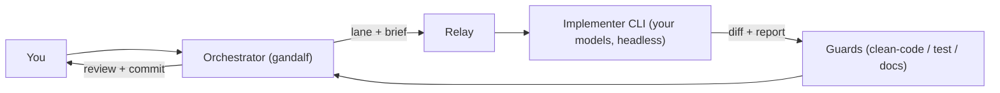

<div align="center">


# gandalf

**A delegation fellowship for your coding agent — any models you have, free or premium.**

*"A wizard is never late, nor is he early. He arrives precisely when he means to."*

[](https://skills.sh/ahmed-elkashif/gandalf)
[](LICENSE)

</div>

---

## What is this

One model cannot be great at everything. A drawer full of premium skills helps
nothing if the wrong model is holding them. And your best model should not spend
its day renaming files.

This repo gives your agent a **delegation fleet**: named lanes, one model per
kind of work, a premium skill set on every member — and a real review before
anything lands. Two skills:

| Skill | Job |
|---|---|
| **[`council-of-elrond`](skills/council-of-elrond/SKILL.md)** | **Setup.** Convenes the council: discovers the CLIs on your machine, casts all eight roles onto the models you have (one question, at most), writes the fleet config, generates lane preambles, checks the gear, verifies the cast. |
| **[`gandalf`](skills/gandalf/SKILL.md)** | **Daily use.** Picks the lane, assembles the brief, dispatches the relay, runs the guards, reviews the diff — and never writes the code himself. |

## Install

```bash
npx skills add Ahmed-ElKashif/gandalf
```

The [skills CLI](https://github.com/vercel-labs/skills) detects your coding
agents (OpenCode, Claude Code, Codex, Cursor, Gemini CLI, Antigravity, and
[many more](https://github.com/vercel-labs/skills#supported-agents)) and
installs **both skills** — globally or per project, as you choose.

<details>
<summary>More ways to install</summary>

```bash
# browse before installing
npx skills add Ahmed-ElKashif/gandalf --list

# one skill only
npx skills add Ahmed-ElKashif/gandalf --skill council-of-elrond
npx skills add Ahmed-ElKashif/gandalf --skill gandalf

# target specific agents
npx skills add Ahmed-ElKashif/gandalf -a opencode -a claude-code

# global, non-interactive (fresh machines, CI)
npx skills add Ahmed-ElKashif/gandalf -g -y

# pin a release (git ref)
npx skills add Ahmed-ElKashif/gandalf#v1.1.0
```

**Manually** — copy a skill folder into your agent's skills directory:

| Target | Path |
|---|---|
| Shared store (OpenCode, Codex, Cursor, Gemini CLI, Antigravity, …) | `~/.agents/skills/<skill>/` |
| Claude Code | `~/.claude/skills/<skill>/` |

</details>

> If the CLI halts on a project-only agent (e.g. PromptScript), re-run targeting
> your own: `-a opencode claude-code cursor gemini-cli`. The canonical copy lands
> in `~/.agents/skills/` either way.

Then give the fellowship its gear — relays, guards, and the per-role packs:

```powershell
skills/gandalf/scripts/install-skills.ps1
```

Or role by role from [`skills/gandalf/references/loadouts.md`](skills/gandalf/references/loadouts.md).

## Quickstart

```text
# 1 — cast the fleet (the council asks one question, at most)
Use $council-of-elrond to set up my delegation fleet

# 2 — put it to work (gandalf routes, reviews, and lands)
Use $gandalf to have the feature lane implement the retry logic in src/sync/, then review and commit it
```

## The loop



The council casts the fleet once; the loop runs every day. Every relay follows
the same contract — self-contained brief in; structured report and a
not-yet-committed diff out; **never commits**: the commit belongs to the reviewer.

## gandalf — run the fellowship

### The quest

**gandalf** merges three things:

- **Delegation machinery** — the orchestrator hands a bounded brief to a separate
  implementer process, then reviews the diff before anything lands.
- **One model per job** — each role goes to the model that fits it and your budget:
  cheap models do the flat roads, your strongest takes the dark ones.
- **A premium skill set for every member** — the UI walker carries taste and design
  skills, the bug hunter carries debugging discipline, the reviewers carry the guards.

### Gandalf & the hobbits

Gandalf is the guide. He chooses **who walks** (the lane), **what they carry**
(the loadout), and **when the road is safe** (the gates). He never carries the
Ring: the orchestrator does not write the code.

The hobbits do the walking — and *you cast your own hobbits*. Free opencode models,
a Claude subscription, a local GPU, an Antigravity seat: if your CLI can reach the
model, it can walk. *"Even the smallest person can change the course of the future."*
When the Balrog shows up — gnarly architecture, subtle concurrency, a long march —
Gandalf the White takes the bridge: the `complex` role, your frontier model, one
deep pass.

<div align="center">

</div>

### The eight roles

The roles are fixed wire names (the machinery and the review duo address lanes by
them); the members behind them are yours to cast:

| Role | What it needs | Carries |
|---|---|---|
| `feature` | strongest all-round coder you can afford | stack packs + Ponytail |
| `ui` | good with visuals, long horizons | craft + DESIGN.md + taste/motion menu |
| `bugfix` | reasoning-heavy, disciplined | systematic-debugging + regression tests |
| `devops` | fast, deterministic | CI/CD packs + workflow hardening |
| `chores` | cheap, steady | pre-commit setup + refactor planning |
| `complex` | frontier reasoning (premium) | slow & thorough — one deep pass |
| `review-main` | a second opinion, any budget | debate-review main pass |
| `review-debate` | a different, stronger challenger | debate-review challenger |

### The shipped preset — free-first

This is the zero-budget starter gandalf was born from — six free OpenCode models,
plus Antigravity's Opus for the two dark-road seats. Swap any line for your own
models and it's still the same skill
([`skills/gandalf/presets/free-first.json`](skills/gandalf/presets/free-first.json)):

| Role | Member (preset) |
|---|---|
| `feature` | DeepSeek V4.1 Free (`high`) — the strongest free agentic coder |
| `ui` | GLM 5.3 Free (`high`) — multimodal, long-horizon |
| `bugfix` | Nemotron 3 Ultra Free — reasoning-heavy |
| `devops` | Nemotron 3.5 Lightning Free — fast |
| `chores` | LongCat 2.5 Free — long-context mechanics |
| `complex` | Claude Opus 4.6 Thinking (agy) — one deep pass |
| `review-main` | Big Pickle (free) |
| `review-debate` | Claude Opus 4.6 Thinking (agy) |

### Bring your own fellowship

Casting is one line per role in `config.json`. Rough idea per budget — full guide in
[`skills/gandalf/references/fleet.md`](skills/gandalf/references/fleet.md):

| Budget | `feature` / `ui` | `bugfix` | `complex` |
|---|---|---|---|
| Free-first (shipped) | free opencode models | free reasoning model | Antigravity seat |
| Subscription | Sonnet-class via `claude-delegate` | strongest cheap reasoner | Opus-class |
| Local-first | Ollama/LM Studio via opencode providers | local reasoning model | whatever cloud you keep for hard days |

If your CLI can run a model, delegate-skills almost certainly has a relay for it
(`opencode`, `agy`, `claude`, `cursor`, `codex`, `warp`) — the loop is identical.

### Rules of the road

| Rule | The quote |
|---|---|
| Gates before landing — every diff passes the guards | *"You shall not pass."* |
| Smallest change that works — the Ponytail ladder | *"Even the smallest person can change the course of the future."* |
| Scope discipline — build what was asked, no more | *"All we have to decide is what to do with the time that is given us."* |
| Two failed attempts → escalate, don't grind | *"Fly, you fools!"* |
| Evidence before claims — real commands, real output | *"The wise speak only of what they know."* |
| Secrets never travel inline in briefs | *"Keep it secret. Keep it safe."* |

### First dispatch

```powershell
node "$env:USERPROFILE\.agents\skills\opencode-delegate\scripts\relay.mjs" `
  --brief "C:\path\to\brief.txt" `
  --cd "C:\path\to\repo" `
  --lane feature `
  --timeout 30m `
  --out-dir "C:\path\to\run-artifacts"
```

The relay runs the implementer headlessly, returns its report and touched files,
and never commits. Review the diff, run the gates, then land it yourself.
Both relay recipes (opencode + agy, PowerShell and bash):
[`skills/gandalf/references/operations.md`](skills/gandalf/references/operations.md).

## council-of-elrond — cast the fellowship

**council-of-elrond** turns "I have some CLIs installed" into "I have a working
fleet" in one pass:

1. **Discover** — probes PATH for implementer CLIs: installed? authenticated?
   which models?
2. **One question** — budget posture: free-first / your subscriptions / local + mixed.
3. **Cast** — all eight roles onto real models; every lane labelled with its Basis.
4. **Write** — shows the table and the full JSON, gets your approval, validates,
   writes `delegate-fleet.v1`.
5. **Preambles** — generates `~/.config/delegate-skills/preambles.md` for the
   actual cast.
6. **Gear + verify** — checks the loadouts, resolves every lane, runs the reviewer
   health pulse.

It ships its own copy of the discovery/validation engine (vendored from
[`amElnagdy/delegate-skills`](https://github.com/amElnagdy/delegate-skills), MIT —
see [`skills/council-of-elrond/NOTICE.md`](skills/council-of-elrond/NOTICE.md)),
so casting needs nothing else installed.

<div align="center">

</div>

## Repository shape

```text
assets/                      README images
skills/
├── gandalf/
│   ├── SKILL.md
│   ├── references/          fleet · loadouts · frontend-formula · operations · gates
│   ├── presets/             free-first.json
│   ├── templates/           fleet.template.json · preambles.example.md
│   └── scripts/             install-skills.ps1
└── council-of-elrond/
    ├── SKILL.md
    ├── NOTICE.md            MIT attribution for the vendored engine
    ├── references/          casting · gear
    ├── presets/             free-first.json
    ├── templates/           preambles.example.md
    └── scripts/             vendored delegate-setup engine (config · discover · implementers · lane)
```

## Credits

- Delegation & review machinery: [`amElnagdy/delegate-skills`](https://github.com/amElnagdy/delegate-skills),
  [`amElnagdy/review-skills`](https://github.com/amElnagdy/review-skills),
  [`amElnagdy/guard-skills`](https://github.com/amElnagdy/guard-skills) — MIT.
  The `delegate-setup` engine is vendored into
  [`council-of-elrond`](skills/council-of-elrond/NOTICE.md).
- [`DietrichGebert/ponytail`](https://github.com/DietrichGebert/ponytail) — the ladder philosophy
- [`obra/superpowers`](https://github.com/obra/superpowers), [`Leonxlnx/taste-skill`](https://github.com/Leonxlnx/taste-skill),
  [`emilkowalski/skills`](https://github.com/emilkowalski/skills), [`vercel-labs/agent-skills`](https://github.com/vercel-labs/agent-skills),
  [`greensock/gsap-skills`](https://github.com/greensock/gsap-skills), [`ibelick/ui-skills`](https://github.com/ibelick/ui-skills),
  [`anthropics/skills`](https://github.com/anthropics/skills), plus the Supabase, Prisma, MongoDB,
  shadcn, NestJS, and LangChain packs
- Models: the free-first preset rides OpenCode's free tier and Antigravity (Google)
- Images: Gandalf stills © Warner Bros. / New Line — included as a fan homage

## License

MIT — see [`LICENSE`](LICENSE). The vendored engine in
`skills/council-of-elrond/scripts/` remains under MIT © 2026 Ahmed Mohammed
([amElnagdy](https://github.com/amElnagdy)) — see
[`skills/council-of-elrond/NOTICE.md`](skills/council-of-elrond/NOTICE.md).

<div align="center">

*"The road goes ever on and on."*

</div>
