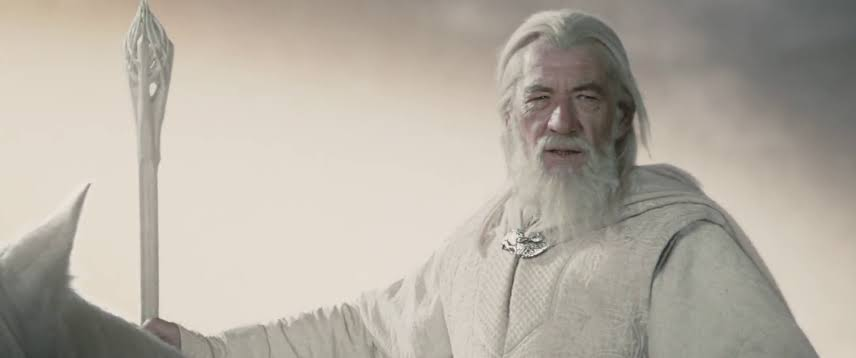
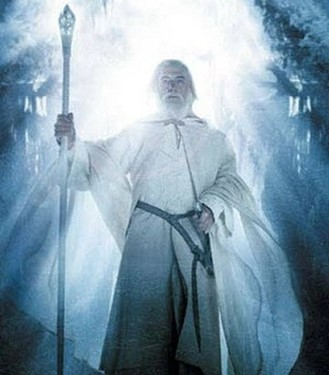
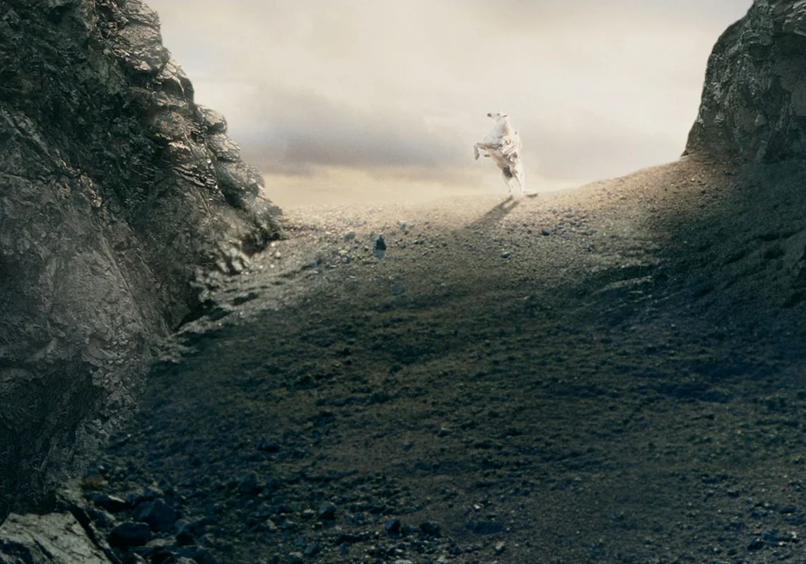

<div align="center">



# 🧙 gandalf

**A wizard to guide your fellowship of model lanes — any models you have.**

*"A wizard is never late, nor is he early. He arrives precisely when he means to."*

</div>

---

## The quest

One model cannot be great at everything. A drawer full of premium skills helps
nothing if the wrong model is holding them. And your best model should not spend
its day renaming files.

**gandalf** is one skill that fixes all three. It merges:

- **Delegation machinery** — the orchestrator hands a bounded brief to a separate
  implementer process, then reviews the diff before anything lands.
- **One model per job** — each role goes to the model that fits it and your budget:
  cheap models do the flat roads, your strongest takes the dark ones.
- **A premium skill set for every member** — the UI walker carries taste and design
  skills, the bug hunter carries debugging discipline, the reviewers carry the guards.

## Gandalf & the hobbits

Gandalf is the guide. He chooses **who walks** (the lane), **what they carry**
(the loadout), and **when the road is safe** (the gates). He never carries the
Ring: the orchestrator does not write the code.

The hobbits do the walking — and *you cast your own hobbits*. Free opencode models,
a Claude subscription, a local GPU, an Antigravity seat: if your CLI can reach the
model, it can walk. *"Even the smallest person can change the course of the future."*
When the Balrog shows up — gnarly architecture, subtle concurrency, a long march —
Gandalf the White takes the bridge: the `complex` role, your frontier model, one
deep pass.

## The eight roles

The roles are fixed wire names (the machinery and the review duo address lanes by
them); the members behind them are yours to cast:

| Role | What it needs | Carries |
|---|---|---|
| `feature` | strongest all-round coder you can afford | stack packs + Ponytail |
| `ui` | good with visuals, long horizons | craft + DESIGN.md + taste/motion menu |
| `bugfix` | reasoning-heavy, disciplined | systematic-debugging + regression tests |
| `devops` | fast, deterministic | CI/CD packs + workflow hardening |
| `chores` | cheap, steady | pre-commit setup + refactor planning |
| `complex` | frontier reasoning (premium) | slow & thorough — one deep pass |
| `review-main` | a second opinion, any budget | debate-review main pass |
| `review-debate` | a different, stronger challenger | debate-review challenger |

## The shipped preset — free-first

This is the zero-budget starter gandalf was born from — five free OpenCode models,
plus Antigravity's Opus for the two dark-road seats. Swap any line for your own
models and it's still the same skill ([`presets/free-first.json`](presets/free-first.json)):

| Role | Member (preset) |
|---|---|
| `feature` | DeepSeek V4.1 Free (`high`) — the strongest free agentic coder |
| `ui` | GLM 5.3 Free (`high`) — multimodal, long-horizon |
| `bugfix` | Nemotron 3 Ultra Free — reasoning-heavy |
| `devops` | Nemotron 3.5 Lightning Free — fast |
| `chores` | LongCat 2.5 Free — long-context mechanics |
| `complex` | Claude Opus 4.6 Thinking (agy) — one deep pass |
| `review-main` | Big Pickle (free) |
| `review-debate` | Claude Opus 4.6 Thinking (agy) |

## Bring your own fellowship

Casting is one line per role in `config.json`. Rough idea per budget — full guide in
[`references/fleet.md`](references/fleet.md):

| Budget | `feature` / `ui` | `bugfix` | `complex` |
|---|---|---|---|
| Free-first (shipped) | free opencode models | free reasoning model | Antigravity seat |
| Subscription | Sonnet-class via `claude-delegate` | strongest cheap reasoner | Opus-class |
| Local-first | Ollama/LM Studio via opencode providers | local reasoning model | whatever cloud you keep for hard days |

If your CLI can run a model, delegate-skills almost certainly has a relay for it
(`opencode`, `agy`, `claude`, `cursor`, `codex`, `warp`) — the loop is identical.

## Rules of the road

| Rule | The quote |
|---|---|
| Gates before landing — every diff passes the guards | *"You shall not pass."* |
| Smallest change that works — the Ponytail ladder | *"Even the smallest person can change the course of the future."* |
| Scope discipline — build what was asked, no more | *"All we have to decide is what to do with the time that is given us."* |
| Two failed attempts → escalate, don't grind | *"Fly, you fools!"* |
| Evidence before claims — real commands, real output | *"The wise speak only of what they know."* |
| Secrets never travel inline in briefs | *"Keep it secret. Keep it safe."* |

## Install

**gandalf** is a standard agent skill — a folder with `SKILL.md` — so any
skill-aware agent can carry it: OpenCode, Claude Code, Cursor, Antigravity,
Gemini CLI, Cline, …

**With the skills CLI** — from a local folder:

```bash
npx skills add "/path/to/gandalf" -g -y
```

Or from your published copy:

```bash
npx skills add <owner>/gandalf -g -y
```

> Note: if the CLI routes a project-only agent (e.g. PromptScript) and exits non-zero,
> re-run targeting your agents: `-a opencode claude-code cursor gemini-cli`. The
> canonical copy lands in `~/.agents/skills/gandalf` either way.

**Manually** — copy this folder into your agent's global skills directory:

| Target | Path |
|---|---|
| Shared store (OpenCode, Antigravity, …) | `~/.agents/skills/gandalf/` |
| Claude Code | `~/.claude/skills/gandalf/` |

Then give the fellowship its gear — companions and per-role loadouts:

```powershell
scripts/install-skills.ps1
```

or run the commands role by role from [`references/loadouts.md`](references/loadouts.md).

## First dispatch

```powershell
node "$env:USERPROFILE\.agents\skills\opencode-delegate\scripts\relay.mjs" `
  --brief "C:\path\to\brief.txt" `
  --cd "C:\path\to\repo" `
  --lane feature `
  --timeout 30m `
  --out-dir "C:\path\to\run-artifacts"
```

The relay runs the implementer headlessly, returns its report and touched files,
and never commits. Review the diff, run the gates, then land it yourself.
Both relay recipes (opencode + agy, PowerShell and bash):
[`references/operations.md`](references/operations.md).

## Gallery

<div align="center">


&nbsp;&nbsp;


</div>

## Credits

- Delegation & review machinery: [`amElnagdy/delegate-skills`](https://github.com/amElnagdy/delegate-skills),
  [`amElnagdy/review-skills`](https://github.com/amElnagdy/review-skills),
  [`amElnagdy/guard-skills`](https://github.com/amElnagdy/guard-skills) — MIT
- [`DietrichGebert/ponytail`](https://github.com/DietrichGebert/ponytail) — the ladder philosophy
- [`obra/superpowers`](https://github.com/obra/superpowers), [`Leonxlnx/taste-skill`](https://github.com/Leonxlnx/taste-skill),
  [`emilkowalski/skills`](https://github.com/emilkowalski/skills), [`vercel-labs/agent-skills`](https://github.com/vercel-labs/agent-skills),
  [`greensock/gsap-skills`](https://github.com/greensock/gsap-skills), [`ibelick/ui-skills`](https://github.com/ibelick/ui-skills),
  [`anthropics/skills`](https://github.com/anthropics/skills), plus the Supabase, Prisma, MongoDB,
  shadcn, NestJS, and LangChain packs
- Models: the free-first preset rides OpenCode's free tier and Antigravity (Google)
- Images: Gandalf stills © Warner Bros. / New Line — included as a fan homage
- License: MIT

<div align="center">

*"The road goes ever on and on."* 🧙

</div>
