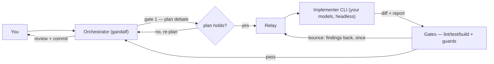

<div align="center">


# gandalf

**A delegation fellowship for your coding agent — any models you have, free or premium.**

*"A wizard is never late, nor is he early. He arrives precisely when he means to."*

[](https://skills.sh/ahmed-elkashif/gandalf)
[](LICENSE)

</div>

---

## What is this

One model cannot be great at everything. A drawer full of premium skills helps
nothing if the wrong model is holding them. And your best model should not spend
its day renaming files.

This repo gives your agent a **delegation fleet**: named lanes, one model per
kind of work, a premium skill set on every member — and a real review before
anything lands. Four skills ship together:

| Skill | Job |
|---|---|
| **[`council-of-elrond`](skills/council-of-elrond/SKILL.md)** | **Setup.** Convenes the council: arms the machine from [`packs.json`](skills/council-of-elrond/packs.json), discovers the CLIs you have, casts the full fellowship onto the models you have (one question, at most), writes the fleet config, generates lane preambles, verifies the cast. |
| **[`gandalf`](skills/gandalf/SKILL.md)** | **Daily use.** Picks the lane, assembles the brief, dispatches the relay, runs the guards, reviews the diff — and never writes the code himself. |
| **[`palantir`](skills/palantir/SKILL.md)** | **UI evidence.** The behaviour gate `qa` runs: the page's own WebMCP tools, the DOM timeline, and the network HAR. A child skill of `gandalf`, installed alongside it. |
| **[`celebrimbor`](skills/celebrimbor/SKILL.md)** | **Design language.** Forges or adopts a validated `DESIGN.md` before `ui` dispatches, so `ui` has a system and `qa-look` has something to judge against. A child skill of `gandalf`. |

## Install

```bash
npx skills add Ahmed-ElKashif/gandalf
```

The [skills CLI](https://github.com/vercel-labs/skills) detects your coding
agents (OpenCode, Claude Code, Codex, Cursor, Gemini CLI, Antigravity, and
[many more](https://github.com/vercel-labs/skills#supported-agents)) and
installs **the skills in this repo** — globally or per project, as you choose.

<details>
<summary>More ways to install</summary>

```bash
# browse before installing
npx skills add Ahmed-ElKashif/gandalf --list

# one skill only
npx skills add Ahmed-ElKashif/gandalf --skill council-of-elrond
npx skills add Ahmed-ElKashif/gandalf --skill gandalf
npx skills add Ahmed-ElKashif/gandalf --skill palantir
npx skills add Ahmed-ElKashif/gandalf --skill celebrimbor

# target specific agents
npx skills add Ahmed-ElKashif/gandalf -a opencode -a claude-code

# global, non-interactive (fresh machines, CI)
npx skills add Ahmed-ElKashif/gandalf -g -y

# pin a release (git ref)
npx skills add Ahmed-ElKashif/gandalf#v1.1.0
```

**Manually** — copy a skill folder into your agent's skills directory:

| Target | Path |
|---|---|
| Shared store (OpenCode, Codex, Cursor, Gemini CLI, Antigravity, …) | `~/.agents/skills/<skill>/` |
| Claude Code | `~/.claude/skills/<skill>/` |

</details>

> If the CLI halts on a project-only agent (e.g. PromptScript), re-run targeting
> your own: `-a opencode claude-code cursor gemini-cli`. The canonical copy lands
> in `~/.agents/skills/` either way.

Then **arm the machine** — the fellowship's gear, installed in the order
[`packs.json`](skills/council-of-elrond/packs.json) lists it:

```powershell
skills/gandalf/scripts/install-skills.ps1      # core + ui
```

That is the Windows convenience path. The recommended one is the council skill
(`$council-of-elrond`), which reads the same file, shows you the delta in one table,
and takes one approval. Per-role detail:
[`skills/gandalf/references/loadouts.md`](skills/gandalf/references/loadouts.md).

## Quickstart

```text
# 1 — cast the fleet (the council asks one question, at most)
Use $council-of-elrond to set up my delegation fleet

# 2 — put it to work (gandalf routes, reviews, and lands)
Use $gandalf to have the feature lane implement the retry logic in src/sync/, then review and commit it
```

## The loop



The council arms and casts the fleet once; the loop runs every day. Every relay
follows the same contract — self-contained brief in; structured report and a
not-yet-committed diff out; **never commits**: the commit belongs to the reviewer.

## gandalf — run the fellowship

### The quest

**gandalf** merges three things:

- **Delegation machinery** — the orchestrator hands a bounded brief to a separate
  implementer process, then reviews the diff before anything lands.
- **One model per job** — each role goes to the model that fits it and your budget:
  cheap models do the flat roads, your strongest takes the dark ones.
- **A premium skill set for every member** — the UI walker carries taste and design
  skills, the bug hunter carries debugging discipline, the reviewers carry the guards.

### Gandalf & the hobbits

Gandalf is the guide. He chooses **who walks** (the lane), **what they carry**
(the loadout), and **when the road is safe** (the gates). He never carries the
Ring: the orchestrator does not write the code.

The hobbits do the walking — and *you cast your own hobbits*. Free opencode models,
a Claude subscription, a local GPU, an Antigravity seat: if your CLI can reach the
model, it can walk. *"Even the smallest person can change the course of the future."*
When the Balrog shows up — gnarly architecture, subtle concurrency, a long march —
Gandalf the White takes the bridge: the `complex` role, your frontier model, one
deep pass.

<div align="center">

</div>

### The roles

Eleven: eight that **walk**, three that **judge**. The roles are fixed wire
names (the machinery and the review trio address lanes by them); the members
behind them are yours to cast. LOTR names are display aliases — use them in
conversation, and keep the wire name beside them.

| LOTR name | Wire name | What it needs | Carries |
|---|---|---|---|
| **Aragorn** | `feature` | strongest all-round coder you can afford | stack packs + Ponytail |
| **Galadriel** | `ui` | good with visuals, long horizons | craft + DESIGN.md (forge with `celebrimbor` if missing) + taste/motion menu |
| **Elrond** | `bugfix` | reasoning-heavy, disciplined | systematic-debugging + regression tests |
| **Gimli** | `devops` | fast, deterministic | CI/CD packs + workflow hardening |
| **Samwise** | `chores` | cheap, steady | pre-commit setup + refactor planning |
| **Glorfindel** | `complex` | frontier reasoning (premium) | slow & thorough — one deep pass |
| **Haldir** | `qa` | patient, sceptical, drives a browser; **no vision needed** | `palantír` — the UI **behaviour** gate |
| **Legolas** | `qa-look` | **vision-capable** — the only seat that needs it | the appearance pass, against `DESIGN.md` |
| **Radagast** | `plan-debate` | a strong, *different* reasoner | attacks the plan before dispatch |
| **Faramir** | `review-main` | a second opinion, any budget | debate-review main pass |
| **Saruman** | `review-debate` | a different, stronger challenger | debate-review challenger |

`qa` is a **behaviour gate, not an advisor**: a UI change isn't done until `qa`
returns a clean `palantír` round on it, and a red round bounces back to `ui`. It
needs no vision. `qa-look` is the **eye**: the only vision seat, judging
appearance against `DESIGN.md`, and its advisory verdict can never override
`qa` — a beautiful broken page still fails. Full method:
[`skills/palantir/SKILL.md`](skills/palantir/SKILL.md).

## The Fellowship — a LOTR-style guide

Gandalf does not march to war alone. He summons the company, grills the plan,
and only returns when the road is safe. The roles carry LOTR names; the wire
names sit beside them and are what the machinery resolves.

### The quest flow

```mermaid
flowchart LR
  Y[You] -->|summon| G[Gandalf]
  G -->|Session 0: grill + intake| I[Intake]
  I -->|DESIGN.md?| D{design language}
  D -->|celebrimbor| C[forge DESIGN.md]
  D -->|have one / none| P[Plan]
  C --> P
  P -->|complex?| R{Radagast?}
  R -->|yes| RD[Radagast attacks]
  R -->|no, skip (recorded)| DI[Dispatch]
  RD -->|holds| DI
  DI --> H[Hobbits walk]
  H --> G2[Guards + qa gate]
  G2 -->|bounce| H
  G2 -->|pass| G3[Review debate]
  G3 --> LR[Landing report]
  LR -->|you say yes| L[Land + push/PR]
```

### How to summon

```text
# 1 — cast the fleet once (the council asks one question, at most)
Use $council-of-elrond to set up my delegation fleet

# 2 — put it to work (Gandalf runs the intake, grills the plan, then the loop)
Use $gandalf to <describe what you want to build>
```

Gandalf runs Session 0 first — he asks what you want to build, grills it, settles
the design language, and decides whether Radagast is needed. Then the war begins.
He comes back **once**, with the landing report, before anything is committed or
pushed. Wire names and full per-role loadouts: [`skills/gandalf/references/fellowship.md`](skills/gandalf/references/fellowship.md).

### The company at a glance

| LOTR name | Wire name | Domain |
|---|---|---|
| Aragorn | `feature` | full-stack / feature |
| Galadriel | `ui` | frontend / design craft |
| Elrond | `bugfix` | debugging / diagnosis |
| Gimli | `devops` | infrastructure / CI-CD |
| Samwise | `chores` | maintenance / mechanical |
| Glorfindel | `complex` | frontier reasoning / architecture |
| Haldir | `qa` | behaviour verification / browser |
| Legolas | `qa-look` | visual verification / the eye |
| Radagast | `plan-debate` | plan challenger |
| Faramir | `review-main` | second-opinion reviewer |
| Saruman | `review-debate` | strong challenger |

Gandalf himself is the orchestrator — the seat you are in. He never carries the
Ring.

### The shipped preset — free-first

This is the zero-budget starter gandalf was born from — free OpenCode models, plus
Antigravity's Opus for the three dark-road seats. Swap any line for your own models and
it's still the same skill
([`skills/gandalf/presets/free-first.json`](skills/gandalf/presets/free-first.json)):

| Role | Member (preset) |
|---|---|
| `feature` | DeepSeek V4.1 Free — the strongest free agentic coder |
| `ui` | GLM 5.3 Free (`high`) — long-horizon craft; picks among the frontend skills |
| `bugfix` | Nemotron 3 Ultra Free — reasoning-heavy |
| `devops` | Nemotron 3.5 Lightning Free — fast |
| `chores` | MiniMax M3.1 Flash Free — the cheapest seat |
| `complex` | Claude Opus 4.6 Thinking (agy) — one deep pass |
| `qa` | Nemotron 3 Ultra Free — the behaviour gate; no vision needed |
| `qa-look` | Nemotron 3.5 Super VL Free — **the only free vision model** in the set |
| `plan-debate` | Claude Opus 4.6 Thinking (agy) — the plan's challenger |
| `review-main` | LongCat 2.5 Preview Free — probe-selected second opinion |
| `review-debate` | Claude Opus 4.6 Thinking (agy) |

The honest trade of a free-only fleet: `complex`, `plan-debate` and `review-debate` all
ride agy Opus, so the two debate judges are the same model. Say so if you cast it that
way — two seats on one model is a legitimate budget choice, but nobody should mistake it
for a second opinion.

### Bring your own fellowship

Casting is one line per role in `config.json`. Rough idea per budget — full guide in
[`skills/gandalf/references/fleet.md`](skills/gandalf/references/fleet.md):

| Budget | `feature` / `ui` | `bugfix` | `complex` |
|---|---|---|---|
| Free-first (shipped) | free opencode models | free reasoning model | Antigravity seat |
| Subscription | Sonnet-class via `claude-delegate` | strongest cheap reasoner | Opus-class |
| Local-first | Ollama/LM Studio via opencode providers | local reasoning model | whatever cloud you keep for hard days |

If your CLI can run a model, delegate-skills almost certainly has a relay for it
(`opencode`, `agy`, `claude`, `cursor`, `codex`, `warp`) — the loop is identical.

### Rules of the road

| Rule | The quote |
|---|---|
| Gates before landing — every diff passes the guards | *"You shall not pass."* |
| Smallest change that works — the Ponytail ladder | *"Even the smallest person can change the course of the future."* |
| Scope discipline — build what was asked, no more | *"All we have to decide is what to do with the time that is given us."* |
| Two failed attempts → escalate, don't grind | *"Fly, you fools!"* |
| Evidence before claims — real commands, real output | *"The wise speak only of what they know."* |
| Secrets never travel inline in briefs | *"Keep it secret. Keep it safe."* |

### First dispatch

```powershell
node "$env:USERPROFILE\.agents\skills\opencode-delegate\scripts\relay.mjs" `
  --brief "C:\path\to\brief.txt" `
  --cd "C:\path\to\repo" `
  --lane feature `
  --timeout 30m `
  --out-dir "C:\path\to\run-artifacts"
```

The relay runs the implementer headlessly, returns its report and touched files,
and never commits. Review the diff, run the gates, then land it yourself.
Both relay recipes (opencode + agy, PowerShell and bash):
[`skills/gandalf/references/operations.md`](skills/gandalf/references/operations.md).

## council-of-elrond — cast the fellowship

**council-of-elrond** turns "I have some CLIs installed" into "I have a working
fleet" in one pass:

1. **Arm** — reads [`packs.json`](skills/council-of-elrond/packs.json), shows one delta table (what is
   missing, its tier, its licence, the roles it serves), takes one approval, and
   installs. `delegate-skills` first, always — so you can pick your implementers
   before anything is cast. Re-arms show only what changed.
2. **Discover** — probes PATH for implementer CLIs: installed? authenticated?
   which models?
3. **One question** — budget posture: free-first / your subscriptions / local + mixed.
4. **Cast** — the full fellowship onto real models; every lane labelled with its Basis.
   `plan-debate` is cast by default when a suitable model is available; whether it is
   used per task is Gandalf's call, never a user question.
5. **Write** — shows the table and the full JSON, gets your approval, validates,
   writes `delegate-fleet.v1`.
6. **Preambles** — generates `~/.config/delegate-skills/preambles.md` for the
   actual cast.
7. **Verify** — resolves every lane, runs the reviewer health pulse.

It ships its own copy of the discovery/validation engine (vendored from
[`amElnagdy/delegate-skills`](https://github.com/amElnagdy/delegate-skills), MIT —
see [`skills/council-of-elrond/NOTICE.md`](skills/council-of-elrond/NOTICE.md)),
so casting needs nothing else installed.

<div align="center">

</div>

## Repository shape

```text
assets/                      README images
skills/
├── gandalf/
│   ├── SKILL.md
│   ├── roles.json           canonical role registry (11 roles: 8 walk, 3 judge)
│   ├── references/          fleet · loadouts · frontend-formula · plan-debate · operations · gates · intake · landing-report · fellowship · prior-art
│   ├── presets/             free-first.json
│   ├── templates/           fleet.template.json · preambles.example.md
│   └── scripts/             fellowship.mjs · preambles.mjs · check-docs.mjs · install-skills.ps1 · tests
├── council-of-elrond/
│   ├── SKILL.md
│   ├── packs.json           the manifest — what to install, and the credits source
│   ├── NOTICE.md            attribution for the vendored engine and the patches
│   ├── patches/             verified diffs for installed third-party skills
│   ├── references/          casting · arming
│   ├── presets/             free-first.json
│   ├── templates/           preambles.example.md (byte-identical to gandalf's)
│   └── scripts/             vendored engine + patch-skills.mjs (apply · check)
├── palantir/                OUR OWN child skill — the qa lane's UI evidence contract
│   ├── SKILL.md
│   ├── references/          webmcp · timeline · coverage-audit · limits · formats
│   ├── scripts/             round.mjs — the evidence runner (start · run · assert · look · stop)
│   └── assets/              recorder.js — the DOM timeline (derived from ui-review-loop)
└── celebrimbor/             OUR OWN child skill — the DESIGN.md forge (ui lane)
    └── SKILL.md
```

## Verify the repo

The workflow is specified in Markdown, so the docs are part of the machinery.
Two mechanical checks keep the contract from drifting:

```bash
npm test        # preamble injector unit tests (node --test)
npm run check   # roles, aliases, template sync, stale copy, dead links, packs URLs, credits coverage
```

`npm run check` fails on the exact regressions that used to need a human review:
a missing role alias, a stale headcount, a hand-prepend instruction, a
council preambles template that no longer matches gandalf's, a `qa-look` lane
missing from `fellowship.mjs`, or a `packs.json` URL pointing at the wrong repo.
On a fork, set `GANDALF_REPO_URL` to the canonical repo URL when running the check;
the CI workflow already does.

## Prior art

The loop is not invented here. It follows patterns that hold up in production:
orchestrator-workers and evaluator-optimizer (Anthropic), owned prompts, context,
and control flow plus small focused agents (12-factor agents), and explicit
guardrails with human checkpoints (OpenAI). The mapping — and what gandalf
deliberately does differently — is in
[`skills/gandalf/references/prior-art.md`](skills/gandalf/references/prior-art.md).

## Verified patches

A reinstall of an upstream skill replaces its files. Three packs need a small fix that
upstream has not taken yet, so the repo carries those fixes as exact unified diffs in
[`skills/council-of-elrond/patches/`](skills/council-of-elrond/patches/):

| Patch | Target | Fix |
|---|---|---|
| `agy-delegate-resolve-binary` | `delegate-skills` → `agy-delegate` | resolve the Antigravity binary outside the current process's PATH |
| `debate-review-snapshot-cleanup` | `review-skills` → `debate-review` | retry a Windows `EPERM` on snapshot cleanup instead of masking the real error |
| `ui-review-loop-version-and-video` | `ui-review-loop` (optional) | separate the version floor from the verified contract; never ship a zero-byte video; find the native CLI on Windows |

Arming runs `node skills/council-of-elrond/scripts/patch-skills.mjs apply` after the
installs. The command is idempotent. `check` verifies without changing anything and
exits nonzero on `pending` or `drift`; `drift` means upstream changed the surrounding
code, and the verifier refuses to guess. A missing optional pack is `skipped`, not an
error. Requires `git` on PATH (`git apply` is the engine).

A patch is not a fork: the dependency stays upstream, and the diff is the smallest
thing that makes the installed copy correct. If upstream takes the fix, delete the
entry.

## Credits

The fellowship stands on other people's work, and it says so. **This list
mirrors [`packs.json`](skills/council-of-elrond/packs.json)** — the same file the
council arms from — so every installable pack is credited here, and nothing here
is credited that is not in the manifest. Listed in install order.

| Pack | Licence | Why it is here |
|---|---|---|
| [`amElnagdy/delegate-skills`](https://github.com/amElnagdy/delegate-skills) | MIT | the relays that run implementers headlessly, plus `delegate-setup` — the engine every `--lane` dispatch resolves through, vendored into [`council-of-elrond`](skills/council-of-elrond/NOTICE.md) |
| [`amElnagdy/review-skills`](https://github.com/amElnagdy/review-skills) | MIT | `debate-review` (the two-lane diff debate) and `babysit-pr` |
| [`amElnagdy/guard-skills`](https://github.com/amElnagdy/guard-skills) | MIT | `clean-code-guard`, `test-guard`, `docs-guard` — the judgment gates |
| [`DietrichGebert/ponytail`](https://github.com/DietrichGebert/ponytail) | MIT | the ladder philosophy behind "the smallest change that works" |
| [`obra/superpowers`](https://github.com/obra/superpowers) | MIT | `writing-plans`, `systematic-debugging`, `receiving-code-review` and the surrounding discipline |
| [`mattpocock/skills`](https://github.com/mattpocock/skills) | MIT | `grilling`, `to-tickets`, `code-review`, `domain-modeling` — the orchestrator's interrogation and the judges' scenario-hunting |
| **`palantír`** — this repo ([`skills/palantir/`](skills/palantir/)) | MIT | **our own child skill.** UI verification through the page's own WebMCP tools plus the DOM timeline and the network HAR — structured evidence instead of a screenshot loop, with vision as *one* deliberate pass on appearance. The `qa` lane's behaviour method; `qa-look` runs its appearance pass |
| **`celebrimbor`** — this repo ([`skills/celebrimbor/`](skills/celebrimbor/)) | MIT | **our own child skill.** The DESIGN.md forge — ensures the project has a current, validated `DESIGN.md` (Extract / Adopt / Generate / Normalize / Stitch) before the `ui` lane dispatches, so `ui` reads it first and `qa-look` judges against it. Methodology only; draws on external methods when installed (VoltAgent/awesome-design-md, stitch-skills, ui-ux-pro-max, impeccable, ibelick/ui-skills) and validates with `@google/design.md`. |
| [`amelnagdy/ui-review-loop`](https://github.com/amelnagdy/ui-review-loop) | Apache-2.0 | **tier `optional`** — the human-watches-video loop, installed only on request. **Not** the `ui`/`qa` evidence path. A verified patch fixes its version gate and silent video failure when it is installed. palantír's recorder is derived from it |
| [`vercel-labs/agent-browser`](https://github.com/vercel-labs/agent-browser) | unverified | the browser backend `palantír` drives. Its experimental WebMCP support is **on by default** for a locally launched Chrome — the channel palantír's tool-call evidence rides |
| [`emilkowalski/skills`](https://github.com/emilkowalski/skills) | MIT | interface craft and motion — `emil-design-eng`, the `animate` family, `apple-design` |
| [`Leonxlnx/taste-skill`](https://github.com/Leonxlnx/taste-skill) | MIT | art direction for public and marketing surfaces |
| [`ibelick/ui-skills`](https://github.com/ibelick/ui-skills) | MIT | the UI systems kit — `baseline-ui`, `create-design-md`, accessibility, metadata |
| [`anthropics/skills`](https://github.com/anthropics/skills) | unverified | `frontend-design`, for explicit visual-identity asks |
| [`vercel-labs/agent-skills`](https://github.com/vercel-labs/agent-skills) | unverified | React best practices and view transitions |
| [`greensock/gsap-skills`](https://github.com/greensock/gsap-skills) | MIT | GSAP timelines, only when GSAP is already a dependency |
| [`supabase/agent-skills`](https://github.com/supabase/agent-skills) | unverified | Supabase / Postgres backends |
| [`prisma/skills`](https://github.com/prisma/skills) | unverified | Prisma projects |
| [`mongodb/agent-skills`](https://github.com/mongodb/agent-skills) | unverified | MongoDB schema and query work |
| [`kadajett/agent-nestjs-skills`](https://github.com/kadajett/agent-nestjs-skills) | unverified | NestJS backends |
| [`wshobson/agents`](https://github.com/wshobson/agents) | MIT | Next.js / Tailwind / TypeScript patterns and GitHub Actions templates |
| [`shadcn-ui/ui`](https://github.com/shadcn-ui/ui) | unverified | shadcn component work |
| [`langchain-ai/langchain-skills`](https://github.com/langchain-ai/langchain-skills) | unverified | LangChain / LangGraph projects |
| [`addyosmani/agent-skills`](https://github.com/addyosmani/agent-skills) | MIT | `ci-cd-and-automation` for the `devops` lane |
| [`github/awesome-copilot`](https://github.com/github/awesome-copilot) | MIT | `github-actions-hardening` for every workflow edit |
| [`getsentry/skills`](https://github.com/getsentry/skills) | Apache-2.0 | `security-review` — **outside the loop**, invoked on demand |

`unverified` means the licence has not been checked yet. That is a to-do, not a
claim — see the note in [`packs.json`](skills/council-of-elrond/packs.json).

Also:

- **Models** — the free-first preset rides OpenCode's free tier and Antigravity (Google).
- **Images** — Gandalf stills © Warner Bros. / New Line, included as a fan homage.

## License

MIT — see [`LICENSE`](LICENSE). The vendored engine in
`skills/council-of-elrond/scripts/` remains under MIT © 2026 Ahmed Mohammed
([amElnagdy](https://github.com/amElnagdy)) — see
[`skills/council-of-elrond/NOTICE.md`](skills/council-of-elrond/NOTICE.md).

<div align="center">

*"The road goes ever on and on."*

</div>
