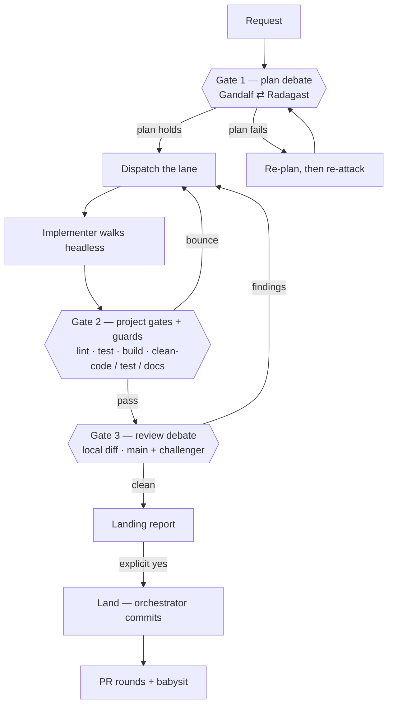

# The plan debate — attack the plan before the hobbits walk

> *"It is the small things, everyday deeds of ordinary folk, that keep the darkness
> at bay."*

The council decides **who** walks. The plan debate decides **what they will
actually do** — and it happens *before* the first dispatch. A bad plan executed by
six lanes is six times the waste, and `debate-review` cannot help you: it sees a
diff, by which point every design decision is already welded into the code. This
gate moves the argument upstream, to where changing your mind costs a paragraph
instead of a branch.

Radagast does not need to be right. He needs to be **unconvinced** — he reads the
plan the way a hostile reviewer reads a diff.

## The three gates



Gate 1 is new. Gates 2 and 3 are `references/gates.md`; the send-back rule that
makes Gate 2 a loop rather than a wall lives there too.

## When it runs

Gandalf decides from the complexity rubric below (also summarized in
`references/intake.md`, step 5). The user is never asked; the decision is recorded
in the landing report.

**Required** when any of these is true:

- the task will touch **more than one file**,
- more than one lane is involved (a lane hand-off counts),
- the lane is `complex`,
- the requirements are ambiguous or have no clear acceptance test,
- a lane has already failed once on this task.

**Skippable** for `chores`-class one-liners — a rename, a dependency bump, a
typo — where the plan is the diff. Gandalf still names the skip in the report.

**The orchestrator decides, and records it in the landing report**: either the plan
that survived the debate, or *"plan debate skipped: single-file chore"*. Never a user
question, never a mid-run check-in. Silence is not an option. A user who cannot see
that a gate was skipped cannot tell it apart from a gate that was forgotten.

If the `plan-debate` lane is uncast, fall back to `review-debate` **and record the
fallback** — the plan is still attacked, by a seat the debate was not sized for. If
neither is cast and the rubric requires the debate, that is a setup blocker: stop
and ask the user to cast a judge. A required gate is never silently simulated; if
the rubric did not require the debate, the uncast seats are irrelevant and the skip
is recorded as usual.

## The protocol

One round, then a verdict. Short, because the plan is cheap to change and the
hobbits are expensive to stop.

1. **Draft (Gandalf).** Write the plan as a brief: what changes, in which files,
   in what order, what the acceptance criteria are, which lane walks, what the
   implementer is explicitly *not* to do. If `writing-plans` is installed, it
   shapes this — its format is better than an improvised one.
2. **Attack (Radagast).** Read-only. He must produce at least one of:
   - a **concrete failure** — the plan breaks a stated constraint, misses a caller,
     or cannot be tested as written;
   - a **cheaper path** — an existing function, an stdlib call, a one-line change
     that makes half the plan unnecessary (this is the Ponytail ladder applied at
     plan altitude — the cheapest place to apply it);
   - a **missing case** — the edge case the plan forgot, with the scenario that
     reaches it.
   "Looks good" is not a verdict. If he genuinely finds nothing, he must say which
   *classes* of failure he checked and why each came back clean.
3. **Revise or stand (Gandalf).** Every objection is either folded into the plan or
   rejected **with a reason**. Unanswered objections are not allowed to disappear —
   if an objection is rejected, it goes in the dispatch brief as a note so the
   implementer knows the landmine is known.
4. **Verdict.** `plan holds` → dispatch. `plan fails` → re-plan and attack once
   more. Two failed rounds → the task is `complex`; say so and escalate the lane.

## What Radagast receives

- The **plan**, in full.
- The **repo, read-only** — he is allowed (and expected) to open the files the plan
  names. A challenge without reading the code is a style opinion.
- The **spec or issue** the task came from, if there is one.
- **Not** a diff, and **not** the implementer's report. There isn't one yet; that
  is the point.

## What comes out

The plan debate produces one artefact — the **dispatch brief**, ready to hand to
the lane, carrying:

- the plan,
- the list of rejected objections with their reasons (the known landmines),
- the acceptance criteria and the gates the implementer must run,
- the standing `do not commit` rule.

That brief is what `references/operations.md` sends. Gate 1 and the dispatch are
the same document on either side of the argument.

## The mechanical check

A skipped plan debate is the one gate whose failure is invisible in a green test
run. At landing, compare the skip reason to the actual change:

```bash
# the merged working tree, before the commit exists
git diff --name-only <base>

# or the union across lane worktrees, before they are merged
git -C <worktree> diff --name-only <base>
```

If the union touches more than one file, a lane hand-off happened, the requirements
were ambiguous, or a lane had already failed once, the skip was wrong. Hold the
debate before commit, record both the original skip and the correction, and do not
pretend the gate ran on time.

## Why not reuse `debate-review`

It was the obvious thing to try, and it does not fit. `debate-review`'s briefs are
git-diff-bound and hardcoded: they hand the challenger `BASE`, `HEAD`, and a
findings list. There is no plan mode, no `--preamble` hook, and no way to hand over
a plan instead of a range. In the one channel it does expose, `{{PR_BODY}}`, the
injection is *defused* — the challenger is brief-blind by design, so it cannot be
steered by what the author wrote. That blindness is exactly right for reviewing a
diff and exactly wrong for attacking a plan, where the plan *is* the input.

So the plan debate is ours; the diff debate stays theirs. One is a conversation
about intent, the other is a machine for auditing patches — and the seam between
them is the `review-debate` seat, which does both when a fleet cannot afford two.
